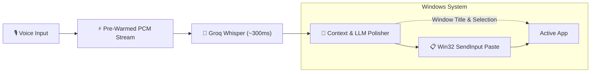

# ⚡ Murmur

> **Ultra-fast, zero-latency, context-aware voice dictation for Windows.**  
> Powered by Whisper Large v3 on Groq LPUs with smart LLM formatting.

[](https://github.com/VijitPugalia/Murmur/releases/latest)
[](https://github.com/VijitPugalia/Murmur)
[](https://dotnet.microsoft.com/)
[](https://groq.com)
[](https://opensource.org/licenses/MIT)

---

## 🌊 Pipeline



---

## ⚡ Shortcuts

| Shortcut | Mode | Action |
| :--- | :--- | :--- |
| <kbd>Ctrl</kbd> + <kbd>Win</kbd> | **Unified (Default)** | **Hold >400ms**: Speak and release to paste<br>**Double-tap**: Hands-free toggle mode |
| <kbd>Alt</kbd> + <kbd>Space</kbd> / <kbd>Win</kbd> + <kbd>H</kbd> / <kbd>F2</kbd> | **1-Click Presets** | Instant switch to alternative keyboard layouts |
| <kbd>Ctrl</kbd> + <kbd>Shift</kbd> + <kbd>V</kbd> | **Paste Again** | Re-pastes the last formatted transcript instantly |

*All shortcuts can be customized in **Settings ➔ Shortcuts** with 1-click presets or custom key combinations.*

---

## ✨ Highlights

* **⚡ Sub-10ms Activation**: Pre-warmed audio buffers and direct dispatch start capturing the millisecond you hit the key.
* **🚀 ~300ms Transcriptions**: Near-instant speech-to-text via Groq LPUs (Whisper Large v3) or OpenAI.
* **🔒 Private Clipboard**: Win32 tags prevent dictation from leaking into Windows Clipboard History (`Win+V`) or cloud sync.
* **📑 Dual-Format Rich Pasting**: Generates both clean Markdown/Unicode and `CF_HTML` envelopes for Word, Google Docs, and Slack.
* **🏝️ Non-Activating Floating Island**: HUD displays real-time audio visualization without stealing window focus from your cursor.
* **🎯 App Personalities & Snippets**: Automatically adapts tone and formatting for code (VS Code), chats (Slack), or emails (Outlook).
* **🔐 Hardware DPAPI Security**: API keys are securely stored on-device in Windows Credential Manager. Zero telemetry.

---

## 🚀 Quick Start

Murmur is packaged as a **single, portable, self-contained Windows executable** (no installer or .NET runtime needed).

1. **Download** [`Murmur.exe`](https://github.com/VijitPugalia/Murmur/releases/latest) from the [Latest Release](https://github.com/VijitPugalia/Murmur/releases/latest).
2. **Run `Murmur.exe`** — sits quietly in your system tray.
3. **Add API Key**: Right-click Murmur tray icon ➔ **Settings** ➔ Paste your free [Groq API Key](https://console.groq.com/keys) (or OpenAI key).
4. **Dictate Anywhere**: Hold <kbd>Ctrl</kbd> + <kbd>Win</kbd>, speak, and release to paste!

---

## 🛠️ Build From Source

```powershell
# Clone repository
git clone https://github.com/VijitPugalia/Murmur.git
cd Murmur

# Run tests
dotnet test Murmur.sln -c Release

# Publish single-file ReadyToRun release
dotnet publish Murmur.App -c Release -r win-x64 --self-contained true -p:PublishSingleFile=true -p:PublishReadyToRun=true
```

---

## 📄 License

MIT License © 2026 Vijit Pugalia & Contributors.
