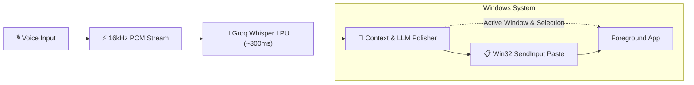

# ⚡ Murmur

> **Free, zero-latency, context-aware voice dictation for Windows.**  
> Powered by Whisper Large v3 on Groq LPUs with intelligent LLM post-processing.

[](https://github.com/VijitPugalia/Murmur)
[](https://dotnet.microsoft.com/)
[](https://groq.com)
[](https://opensource.org/licenses/MIT)

---

## 🌊 How It Works



---

## ⚡ Keyboard Shortcuts

| Shortcut | Mode | Behavior |
| :--- | :--- | :--- |
| <kbd>Ctrl</kbd> + <kbd>Win</kbd> | **Hold-to-Talk (Default)** | Speak while holding; auto-transcribes and pastes on release |
| <kbd>Ctrl</kbd> + <kbd>Alt</kbd> + <kbd>Space</kbd> | **Toggle Mode** | Press once to start recording, press again to finish |
| <kbd>Ctrl</kbd> + <kbd>Shift</kbd> + <kbd>V</kbd> | **Paste Again** | Re-pastes the last formatted transcript instantly |

> *All hotkeys can be customized directly in the **Settings** window under **Dictation Shortcuts** — choose from popular presets or configure your own custom modifier and key combinations.*

---

## ✨ Features

- **⚡ Sub-Second Speed**: Transcriptions return in ~250–400ms using Groq's high-speed LPU inference engine.
- **📜 Searchable Dictation History**: Dedicated floating history panel with instant search, copy, delete, and 1-click **Paste Again** into target apps.
- **🔊 Tactile Audio Feedback**: Pure in-memory synthesized audio cues for recording start, completion confirmation, and cancellation.
- **🎯 Per-App Dictation Personalities**: Tailored prompts for VS Code (code backticks, camelCase), Slack (casual conversational), and Outlook/Email (professional).
- **🗣️ Voice Snippets**: Automatic expansion of spoken trigger phrases into text templates (e.g. saying *"shrug emoji"* types `¯\_(ツ)_/¯`).
- **🧠 Context Awareness**: Inspects foreground app window titles and selected text to tailor vocabulary and capitalization.
- **✍️ In-Place Edit Mode**: Select any text in any app, trigger dictation with an edit instruction (*"make this polite"*, *"fix grammar"*), and Murmur replaces the selection with polished output.
- **🏝️ Dynamic Floating Waveform**: Discreet, non-intrusive floating island HUD with real-time audio visualization.
- **🔒 Zero Leaks & Hardware DPAPI**: API credentials stay encrypted on-device via Windows Credential Manager. No telemetry or analytics.
- **📋 Non-Destructive Clipboard**: Restores your previous clipboard buffer within milliseconds after inserting text.
- **🌐 Any OpenAI-Compatible Provider**: Works out-of-the-box with free Groq, OpenAI, Ollama, or custom self-hosted endpoints.

---

## 🚀 Download & Installation

Murmur is packaged as a **self-contained standalone Windows executable** — no .NET runtime, SDK, or installers required.

| File | Size | Description |
| :--- | :--- | :--- |
| **`Murmur.exe`** | **~91 MB** | **Standalone Executable** — Just download and double-click to run! |
| **`Murmur-Windows-1.0.0-win-x64.zip`** | **~85 MB** | Compressed release archive |

### Installation Steps:
1. **Download** the latest `Murmur.exe` directly from [GitHub Releases](https://github.com/VijitPugalia/Murmur/releases).
2. **Double-click `Murmur.exe`** — it runs immediately in your Windows System Tray (no installation wizard required).
3. **Add your API Key**:
   - Right-click the Murmur tray icon ➔ **Settings**.
   - Paste your free [Groq API Key](https://console.groq.com/keys) (or OpenAI key).
4. **Dictate**: Hold <kbd>Ctrl</kbd> + <kbd>Win</kbd> in any app or text box, speak naturally, and release to paste!

---

## 🛠️ Build From Source

### Prerequisites
- Windows 10/11 (x64 / ARM64)
- [.NET 8.0 SDK](https://dotnet.microsoft.com/download/dotnet/8.0)

```powershell
# Clone repository
git clone https://github.com/VijitPugalia/Murmur.git
cd Murmur

# Build and run tests
dotnet test Murmur.sln

# Create self-contained single-file release
.\build-release.ps1 -X64Only
```

Output binary will be located in `releases/v1.0.0/`.

---

## 📄 License

MIT License © 2024–2026 Murmur Contributors.
